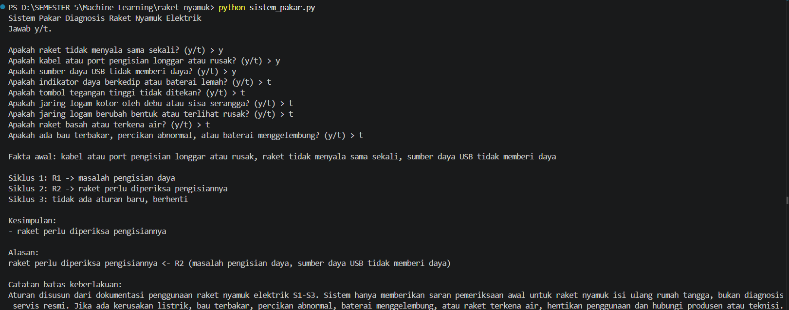
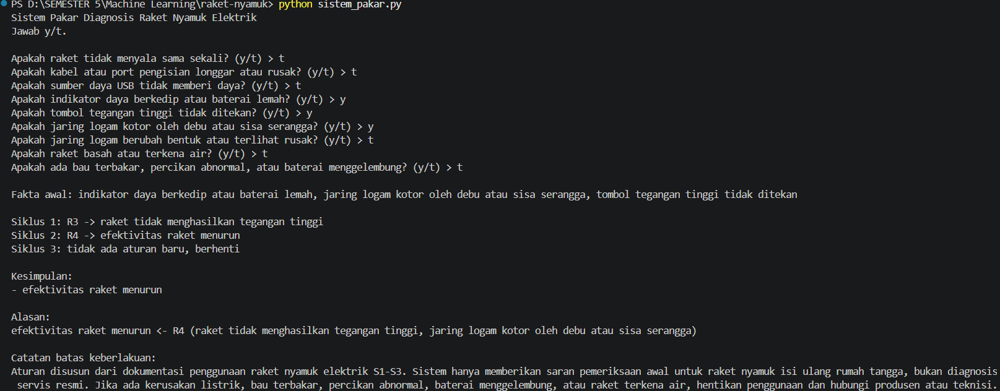
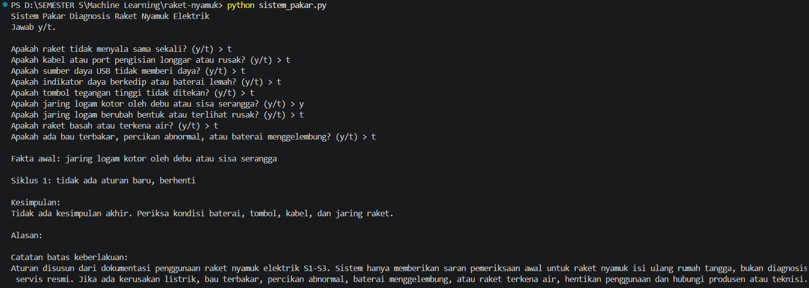

# Sistem Pakar Diagnosis Raket Nyamuk Elektrik

**Nama:** [Muhammad Ravi Rayvansyah]  
**NIM:** [F1D02410078]  

## Topik

Sistem pakar sederhana untuk membantu mendiagnosis masalah raket nyamuk elektrik isi ulang, seperti tidak menyala, tidak menghasilkan tegangan tinggi, atau tidak aman digunakan. Sistem memakai **Forward Chaining (FC)**.

## Cara menjalankan

Bahasa: Python 3.8+

```bash
python sistem_pakar.py
```

Program membaca `kb_raket_nyamuk.json`, menanyakan gejala kepada pengguna, menjalankan forward chaining, lalu menampilkan kesimpulan beserta aturan dan sumber yang dipakai.

## Metode: Forward Chaining

Forward chaining dimulai dari fakta yang diketahui. Sistem mencari aturan yang syaratnya terpenuhi, menambahkan hasil aturan ke memori, lalu mengulangi proses sampai tidak ada aturan baru.

## Daftar sumber

| Kode | Judul | Penerbit | URL |
|---|---|---|---|
| S1 | User Manual Electric Mosquito Swatter Model XQN-898 | Produsen | https://media.s-bol.com/JzJ8zXNjzklo/original.pdf |
| S2 | Electric Mosquito Swatter Instruction Manual | Produsen | https://ae-pic-a1.aliexpress-media.com/kf/Sb34036ed9ba044669482c6441ecb5b41V.pdf |
| S3 | 4-in-1 USB Rechargeable Electric Mosquito Swatter User Manual | Produsen | https://ae-pic-a1.aliexpress-media.com/kf/S1a996266f66e47c7bc31ee3ee04303abl.pdf |

## Tabel aturan

| Aturan | IF | THEN | Sumber |
|---|---|---|---|
| R1 | Raket tidak menyala **ATAU** kabel/port pengisian longgar/rusak | Masalah pengisian daya | S2 |
| R2 | Masalah pengisian daya **DAN** sumber daya USB tidak memberi daya | Raket perlu diperiksa pengisiannya | S2 |
| R3 | Indikator daya berkedip **ATAU** tombol tegangan tinggi tidak ditekan | Raket tidak menghasilkan tegangan tinggi | S1 |
| R4 | Raket tidak menghasilkan tegangan tinggi **DAN** jaring logam kotor | Efektivitas raket menurun | S3 |
| R5 | Jaring logam rusak **ATAU** raket basah/terkena air | Raket tidak aman digunakan | S3 |
| R6 | Ada bau terbakar, percikan abnormal, atau baterai menggelembung | Hentikan penggunaan segera | S1 |
| R7 | Raket tidak aman digunakan **DAN** hentikan penggunaan segera | Perlu servis atau penggantian | S3 |

## Kasus uji

1. **Kasus 1:** raket tidak menyala, kabel/port bermasalah, dan sumber USB tidak memberi daya. Hasil: `raket perlu diperiksa pengisiannya`.
2. **Kasus 2:** indikator berkedip, tombol tegangan tinggi tidak ditekan, dan jaring kotor. Hasil: `efektivitas raket menurun`.
3. **Kasus 3:** jaring rusak, raket basah, dan ada bau terbakar/percikan abnormal/baterai menggelembung. Hasil: `perlu servis atau penggantian`.
4. **Kasus 4 (negatif):** hanya jaring logam kotor. Hasil: tidak ada kesimpulan akhir.





## Batas keberlakuan

Pengetahuan sistem berasal dari tiga dokumentasi penggunaan raket nyamuk elektrik, yaitu S1, S2, dan S3. Sistem hanya memberi saran pemeriksaan awal untuk raket nyamuk isi ulang rumah tangga dan tidak menggantikan teknisi atau layanan resmi produsen. Bila terdapat kerusakan listrik, bau terbakar, percikan abnormal, baterai menggelembung, atau raket terkena air, penggunaan harus dihentikan dan produk perlu diperiksa oleh pihak yang berkompeten. [18][23][24]

## Penggunaan alat bantu AI

Digunakan untuk melihat contoh sintaks program dari judul lain, yaitu banjir. Dari sintaks program banjir kemudian dibuat program dengan judul raket_nyamuk ini.
